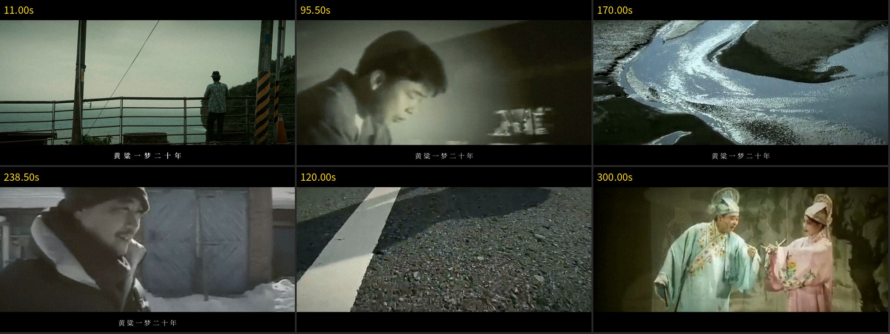
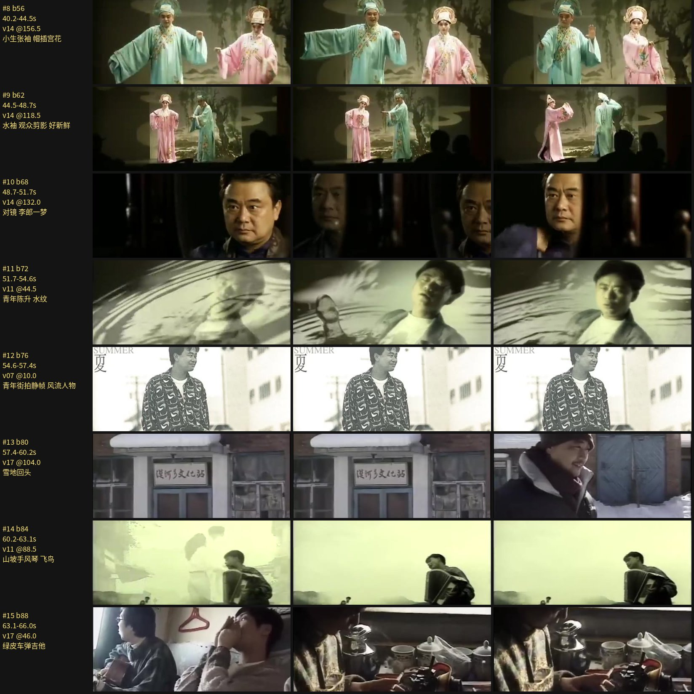
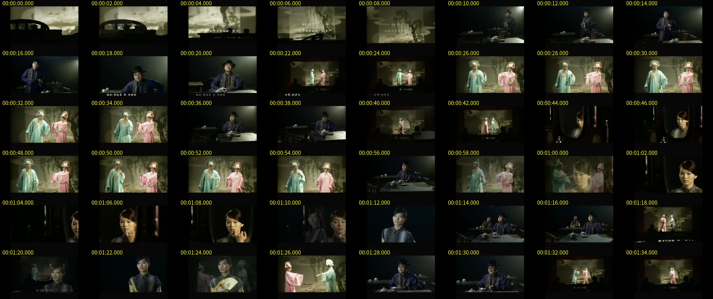

# 用 Claude Opus 5.5 剪一支 MAD：陈升《牡丹亭外》全歌向 MAD 工作流

这是一个完整的 AI 视频剪辑工作流：给 Claude Opus 5.5（在 Claude Code 里运行）一包陈升的 MV 和演唱会录像，告诉它"按照你的心意剪"，它独立完成选曲、构思、选镜头、剪辑、调色、字幕和封面。

仓库里是它实际用过的全部脚本、镜头目录、剪辑表和歌词时间轴，以及剪完的成片。

- **成片下载**：[Releases › v1.0](https://github.com/acprk/opus-mad-workflow/releases/tag/v1.0)（1080p，5 分 18 秒，119 个镜头）
- **投稿用的标题与简介**：[`output/B站投稿_标题与简介.md`](output/B站投稿_标题与简介.md)
- **封面**：[`output/封面_1920x1080.jpg`](output/封面_1920x1080.jpg)



## 构思

《牡丹亭外》开头和结尾是同一段黄梅调——"为救李郎离家园，谁料黄榜中状元"。模型把它理解成一场梦：入梦和出梦唱的是同一出戏，中间就是"黄粱一梦二十年"。

于是整支片子以《牡丹亭外》MV 里在茶馆看戏的长衫客为线索，戏台上演的是他自己这些年：
对镜卸帽 → 青年陈升 → 雨夜独行 → 红桥上两把白伞相向而行 → "写歌的人"是录音棚里的他、"听歌的人"是满座的听众 → 公路与火车 → 雨后长堤上的归人 → 最后一遍"黄粱一梦二十年"四个镜头按年纪排（雪地青年 → 中年 → 白发举杯）→ 对镜卸妆，戏台叠化成空台。

## 工作流

模型没法直接"看"视频，也听不到声音，所以每一步都要先把视频和音频变成它能读的东西。

| 步骤 | 做什么 | 脚本 / 产物 |
|---|---|---|
| 1. 素材索引 | 每个视频做镜头切分；每 2 秒截一帧，拼成带时间码的 8×6 缩略图板（共 75 张） | `work/prep.py` → `work/sources.json`, `work/index/` |
| 2. 镜头目录 | 4 个子代理分头看缩略图板，给每段素材写镜头表：画面、景别、情绪、烧录字幕位置、评分、意象对应 | `work/catalog/v01.md … v18.md` |
| 3. 有效画面区 | `cropdetect` 测出每个源的黑边，原 MV 的歌词字幕多数在黑边里 | `work/cropdet.py` |
| 4. 节拍 | librosa 测节拍并拟合稳定网格（83.98 BPM），发现每句歌词都落在小节第一拍（拍号 36+8k） | `work/beats.py`, `work/grid.py` → `work/beats.json` |
| 5. 歌词 | 网上 LRC 做时间轴；各站写法有分歧的句子，用 whisper 对候选歌词强制解码打分来定（如"怕不能遇见你"胜过"马不能越千里"） | `work/asr.py`, `work/score_lyrics.py` → `work/lyrics.json` |
| 6. 剪辑表 | 按拍号排 119 个镜头：素材、入点、速度、推镜、转场（硬切/叠化/闪白/黑场）、调色；修正写在覆盖表 `FIX`/`FIX2` 里，保留每一轮的修改痕迹 | `work/edl_build.py` → `work/edl.json` |
| 7. 故事板自检 | 每个镜头按实际裁切取首、中、尾三帧拼板，逐张检查：混进相邻镜头的帧、黑场、原片字幕、裁不掉的竖排歌词 → 回到第 6 步改，共三轮 | `work/storyboard.py` → `work/board/` |
| 8. 渲染 | ffmpeg 预处理每个镜头（裁成 2.35:1、放大、调色）；Python 合成器做推镜、转场、字幕、胶片颗粒和暗角；5 路并行渲染后无损拼接，混入 -14 LUFS 母带 | `work/render.py`, `work/final.py` |
| 9. 成片抽帧复查 | 抽关键时间点（标题卡、戏词、副歌、拼接点、片尾）核对 | `work/probe_frames.py` |
| 10. 封面与简介 | PIL 合成封面；写投稿标题、简介和版权说明 | `work/cover/cover.py`, `output/` |

故事板自检示例（每行是一个镜头的首 / 中 / 尾帧）：



缩略图板示例（子代理就是读这样的图来写镜头目录）：



几个设计取舍：

- **全片 2.35:1 遮幅**：很多老 MV 本身是宽银幕加黑边、歌词在黑边里，裁成 2.35:1 就自然去掉了原片字幕；新字幕放在下方黑边，黄梅调戏词用竖排楷书放在画面右侧。
- **剪辑点吸附节拍网格**：字幕起点吸附到小节线，剪辑点用拍号而不是秒来写，改节奏只改拍号。
- **改动只写覆盖表**：故事板发现的问题都记在 `FIX` 里（按起始拍号索引），原始构思保持可读。

## 复现

依赖：Python 3.10+、ffmpeg、`numpy opencv-python pillow librosa openai-whisper`，以及中文字体（Ubuntu：`fonts-noto-cjk fonts-arphic-gkai00mp`）。

```bash
# 1. 把素材放进 src/（以及可选的 extra/），BGM 视频为 src/牡丹亭外.mp4
ffmpeg -i src/牡丹亭外.mp4 -vn -ac 2 -ar 48000 work/bgm_full.wav
ffmpeg -i work/bgm_full.wav -af "volume=-1.5dB,alimiter=limit=0.85:level=false,afade=t=out:st=311:d=7.5" work/bgm_master.wav

# 2. 索引与分析
python3 work/prep.py        # 镜头切分 + 缩略图板（之后由模型/子代理写 work/catalog/）
python3 work/beats.py && python3 work/grid.py

# 3. 剪辑表 → 故事板 → 渲染
python3 work/edl_build.py
python3 work/storyboard.py          # 全部镜头；也可只传编号：storyboard.py 12 15
python3 work/render.py --preview    # 半分辨率预览
python3 work/final.py 5             # 1080p，5 路并行
```

`sources.json` 里的视频编号（v01–v18）对应的文件名见该文件；素材本身不在仓库里。项目根目录可以用环境变量 `MAD_ROOT` 指定。

`work/hd_download_list.txt` 是后来整理的一份高清素材清单（官方 MV 与高清现场，YouTube 视频 ID），配合 `work/dl_retry.py` 慢速下载；这一版成片还没有用上它们。

## 目录

```
work/            全部脚本与数据（EDL、歌词时间轴、节拍、素材索引）
work/catalog/    18 段素材的镜头目录（子代理写的）
work/cover/      封面合成脚本
output/          投稿标题与简介、封面
docs/            README 用图
```

## 坦白说明

- 模型听不到声音：节拍和响度是测出来的，歌词时间对齐过，但口型、气口、情绪的对位没有"亲耳"确认。
- 大部分素材是 360p 老片源，放大到 1080p 偏软。
- 歌词以网上 LRC 为底并做了校对，仍可能有个别字与原唱不一致。

## 版权

代码以 MIT 协议开源（见 [LICENSE](LICENSE)）。

音乐：陈升《牡丹亭外》（专辑《美丽的邂逅》）。画面素材来自陈升的 MV 与演唱会录像（完整列表见 `output/B站投稿_标题与简介.md`）。成片为非商业同人剪辑，音乐、画面、歌词的版权归原作者及唱片公司所有，不在 MIT 协议范围内；如权利人认为不妥，请提 issue，会及时下架。

剪辑：Claude Opus 5.5（Anthropic）　助手：提供片源、帮忙发布
